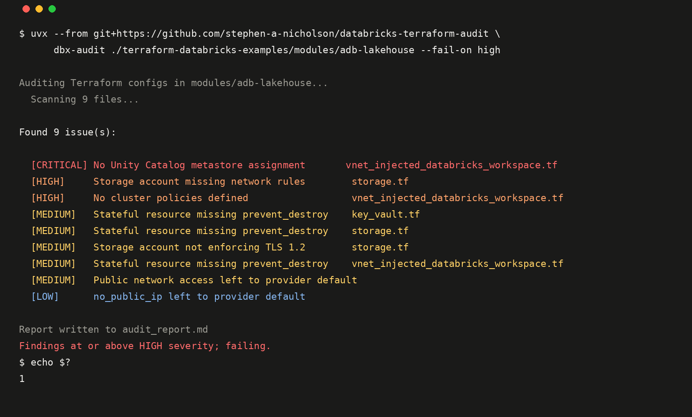

# databricks-terraform-audit

Audits Databricks Terraform for security, standards and platform misconfigurations, and explains why each one matters.

Point it at a directory of `.tf` files. It parses them properly (no regex), runs a fixed set of rules, and produces a severity-ranked report with a suggested fix for each finding. It runs locally in a couple of seconds, or as a GitHub Action on every pull request. No Terraform CLI, no cloud credentials, no API keys.



## Why this exists

A Databricks workspace deployed through the portal, or by an AI agent, or by a colleague who left, can run fine for months and still be unable to answer the question a security reviewer will eventually ask: why is it configured this way? Most of the costly mistakes on Azure Databricks (managed networking instead of VNet injection, a workspace on the legacy Hive metastore, Contributor at subscription scope) are invisible until someone asks, and some of them can only be fixed by rebuilding the workspace.

This tool asks the question first. Every rule in [`docs/RULES.md`](docs/RULES.md) says what it checks and why it matters, so the output is something you can hand to a reviewer, not just a list of red icons.

## Quick start

```bash
git clone https://github.com/stephen-a-nicholson/databricks-terraform-audit.git
cd databricks-terraform-audit
uv sync

# Against the shipped example (deliberately broken)
uv run python main.py examples/sample-terraform/

# Against your own Terraform
uv run python main.py /path/to/your/terraform/
```

Or install it as a tool:

```bash
uv tool install git+https://github.com/stephen-a-nicholson/databricks-terraform-audit
dbx-audit /path/to/your/terraform/
```

### Options

```
dbx-audit TARGET_DIR [OPTIONS]

  -o, --output PATH          Where to write the report (default: audit_report.md). Use - for stdout.
  -f, --format [markdown|json]  JSON is for CI and other tooling.
  --fail-on [critical|high|medium|low|none]
                             Exit 1 if any finding is at or above this severity (default: none).
  --no-recursive             Only scan TARGET_DIR itself. Subdirectories are scanned by default;
                             .terraform/ is always skipped.
  -q, --quiet                No progress output.
```

Subdirectories are scanned as one project, so a check like "is there a metastore assignment anywhere" looks across `workspace.tf`, `unity_catalog.tf` and the module under `modules/`, rather than flagging each file for what lives in the one next to it.

## Profiles

Rules are grouped into cumulative profiles, because a HIGH that matters to a bank is noise to a startup with open egress.

- **baseline** (default): VNet injection, Unity Catalog, cluster policies, SKU, storage network rules, provider pinning, `prevent_destroy`, tags. Every production workspace.
- **hardened**: baseline plus back-end and front-end Private Link, storage private endpoints, customer-managed keys, serverless NCC, private DNS, egress control. What the [Databricks Security Reference Architecture](https://github.com/databricks/terraform-databricks-sra) implements; its `azure/tf` tree passes all seven.

Pick one with `--profile hardened` or a `.dbx-audit.toml` in the repo, which can also override required tags and switch individual rules off with a reason:

```toml
profile       = "hardened"
required_tags = ["Environment", "Owner", "CostCentre"]

[rules.H004]
enabled = false
reason  = "CMK is provisioned by the landing zone, not this repository"
```

## In a pull request

```yaml
# .github/workflows/terraform-audit.yml
name: Terraform audit
on: [pull_request]

jobs:
  audit:
    runs-on: ubuntu-latest
    steps:
      - uses: actions/checkout@v4
      - uses: stephen-a-nicholson/databricks-terraform-audit@v0.1.0
        with:
          path: infra/
          fail-on: high
```

The job fails on any CRITICAL or HIGH finding, the full report goes into the job summary, and it's uploaded as an artifact. Set `fail-on: none` to run it as advisory only.

## Alongside Checkov and Trivy

Run them too. They cover general Azure and storage hardening with thousands of policies; between them they have two rules for Databricks (Checkov: private link for the control plane, CMK for DBFS root) and Trivy has none. This tool is the Databricks layer: networking model, Unity Catalog, cluster governance, SKU, and the provider defaults that quietly decide whether a workspace is public. On Databricks' own examples the two sets of findings had no overlap; see [`docs/experiments/`](docs/experiments/README.md).

## What it checks

Fifteen baseline rules across three areas, plus seven in the hardened profile. Each one is documented in [`docs/RULES.md`](docs/RULES.md) with the reasoning.

| Area | Examples |
|---|---|
| **Security** | Public network access, storage network rules, TLS version, role assignments at subscription scope |
| **Standards** | Required tags, provider pinning, `terraform` block, `prevent_destroy` on stateful resources, hardcoded IDs |
| **Databricks** | VNet injection, secure cluster connectivity, Unity Catalog metastore assignment, legacy Hive metastore, cluster policies, workspace SKU |
| **Hardened** | Back-end and front-end Private Link, storage private endpoints, customer-managed keys, serverless NCC, private DNS zone, egress control |

The rules encode the defaults I've converged on across client platform builds. They won't all fit every organisation; fork the repo and edit the constants at the top of each `checks/*.py` module, or open an issue if you think a default is wrong.

## The AI layer

The Python checks are deterministic and catch known patterns. The three Claude Code subagents in `.claude/agents/` sit on top for the questions a fixed rule can't answer:

- **security-checker**, **standards-checker**, **databricks-checker**: each has read-only access (`Read`, `Grep`, `Glob`) and a brief describing what good looks like in its area.
- They explain *why* a specific configuration is risky in the context of the rest of the project, and suggest fixes that fit how the code is already structured rather than a generic snippet.
- They also look for things the deterministic rules don't cover yet: NSG rules on the Databricks subnets, diagnostic settings, `databricks_workspace_conf` defaults, PAT tokens left enabled.

Open the repo in [Claude Code](https://docs.anthropic.com/en/docs/claude-code/overview) and ask:

```
Run the databricks checker against ./infra and explain the two most important findings
```

The pattern is the point: the tool drafts, a reviewer (human or agent) has to be able to explain every line, and the explanations are the deliverable. The code is just the evidence.

## Development

```bash
uv sync --extra dev
uv run pytest -q         # 31 tests, including the two shipped examples
uv run ruff check .
```

`examples/clean-terraform/` is a small multi-file platform that must produce zero baseline findings and fail hardened in six known places. `examples/hardened-terraform/` adds Private Link, CMK, NCC, DNS and egress and must pass hardened clean. `examples/sample-terraform/` is a single file that must keep its three criticals. Both are asserted in CI, so a rule change that introduces a false positive fails the build.

To add a rule, see the bottom of [`docs/RULES.md`](docs/RULES.md).

## Run against real code

[`docs/experiments/`](docs/experiments/README.md) has the results of running the tool over every Azure example and module in Databricks' own Terraform examples repo: 131 findings across 29 directories, and one false positive in this tool that the exercise caught.

## Licence

MIT.
