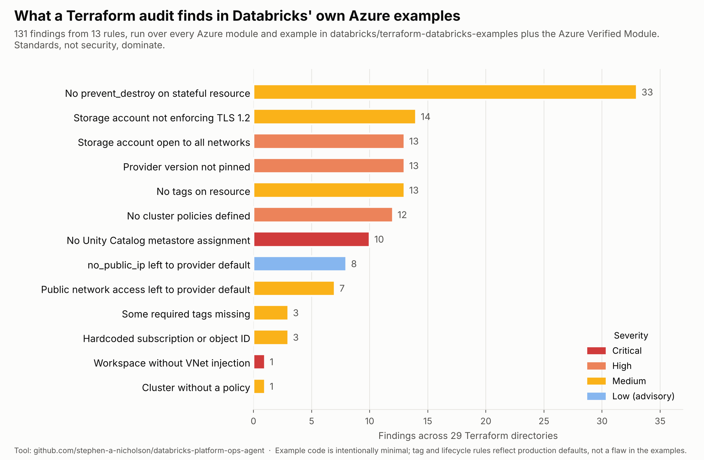
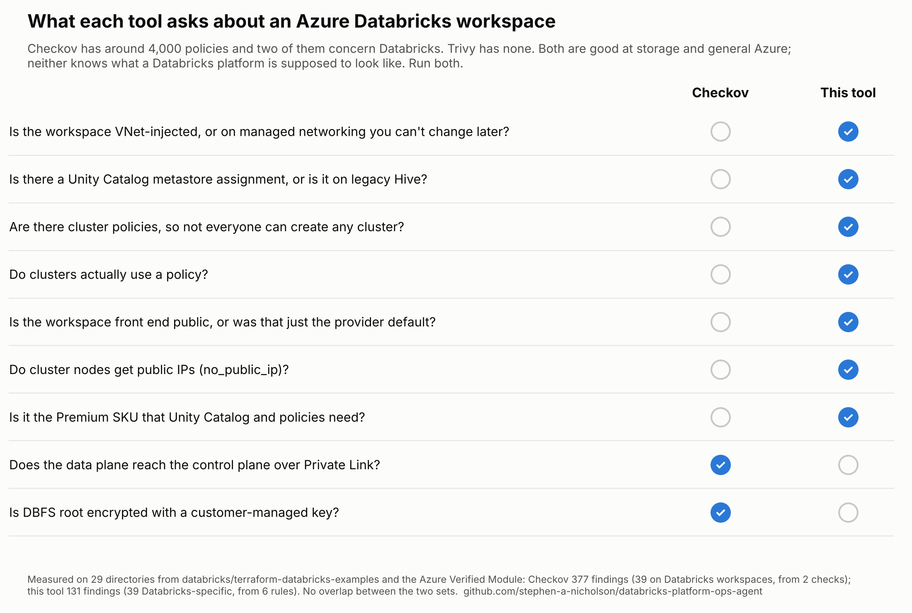

# Experiment: Databricks' own Azure examples

Run on 16 October 2026 against every Azure (`adb-*`) module and example in
[databricks/terraform-databricks-examples](https://github.com/databricks/terraform-databricks-examples)
plus [Azure/terraform-azurerm-avm-res-databricks-workspace](https://github.com/Azure/terraform-azurerm-avm-res-databricks-workspace):
29 directories, 131 findings.

What it told me, in order of usefulness:

1. **My own tool had a false positive.** The first run flagged eight workspaces for
   "secure cluster connectivity not enabled" because `no_public_ip` was unset. The
   azurerm provider has defaulted that to `true` since v3.104.0, so every one of
   those was wrong. The rule is now HIGH only when it is explicitly `false`, and LOW
   advisory when unset. Running a tool over code you did not write is the fastest
   way to find out what it does not understand.
2. **Standards, not security, dominate.** The biggest bar is `prevent_destroy`
   missing on storage accounts and workspaces. Example code has no reason to set it,
   so that is a comment on production defaults rather than the examples. Same for
   tags, which reflect my required set, not a universal one.
3. **The security findings cluster on storage accounts**: 13 with no network rules
   and 14 not enforcing TLS 1.2. Those are two lines each and worth copying into
   any example that will be forked.
4. **Ten "no metastore assignment" criticals are mostly scope.** The modules that
   provision a workspace leave Unity Catalog to a separate module by design, and the
   tool cannot see across repositories. On a real project they would live in the
   same repo and the finding would be fair. The one genuine critical is the
   Overwatch main workspace module, which creates a workspace with managed
   networking and no VNet injection.

## Against the Security Reference Architecture

The fairer test is [databricks/terraform-databricks-sra](https://github.com/databricks/terraform-databricks-sra),
Databricks' own security-first reference deployment, run as one project over the
whole `azure/tf` tree (51 files, 7 modules). Result: zero criticals, one high, three
mediums, one low.

- The high is real: the SRA defines no `databricks_cluster_policy`. It is a
  networking and governance reference, so that is scope rather than oversight, but a
  team forking it as their starting point would ship without cluster governance.
- The three mediums are `prevent_destroy` on the catalog storage account, the hub
  Key Vault and the workspace. Reasonable for a reference; I would want them on a
  real deployment.
- Everything structural passes: VNet injection, `no_public_ip`, Premium SKU,
  metastore assignment, storage network rules, front-end public access tied to a
  Private Link variable.

The run also found the second provider-default bug in this tool: the TLS rule
flagged the SRA's catalog storage account for not setting `min_tls_version`, and
the provider has defaulted new accounts to `TLS1_2` for years. Now LOW advisory when
unset, HIGH only when explicitly set lower. Raw output in `sra.json`.

## Against Checkov

Checkov 3.3.29 run over the same 29 directories, `--framework terraform`, no
external module download:

| | Findings | On Databricks workspaces | From how many rules |
|---|---|---|---|
| Checkov | 377 | 39 | 2 (`CKV_AZURE_158` private link, `CKV2_AZURE_48` CMK for DBFS root) |
| This tool | 131 | 39 | 6 |

The two sets of Databricks findings do not overlap at all. Checkov's two
checks are enterprise hardening on a workspace that is otherwise assumed
correct; this tool's rules are about whether the workspace is structurally
right (networking model, governance, cluster governance, SKU). Checkov's other
338 findings are mostly storage-account hardening (shared key auth, SAS expiry,
soft delete, customer-managed keys) that this tool does not attempt. Trivy's
check library has no Databricks rules at all. The honest conclusion is to run
both: Checkov or Trivy for general Azure, this for the Databricks layer.

Reproduce: clone the two repos, run `main.py <dir> -q -f json -o results/<name>.json`
per directory, then `python chart.py` with `summary.json` in `results/`. For Checkov, `checkov -d <dir> --framework terraform -o json --skip-download` per directory, then `comparison.json` and `matrix.py`.
